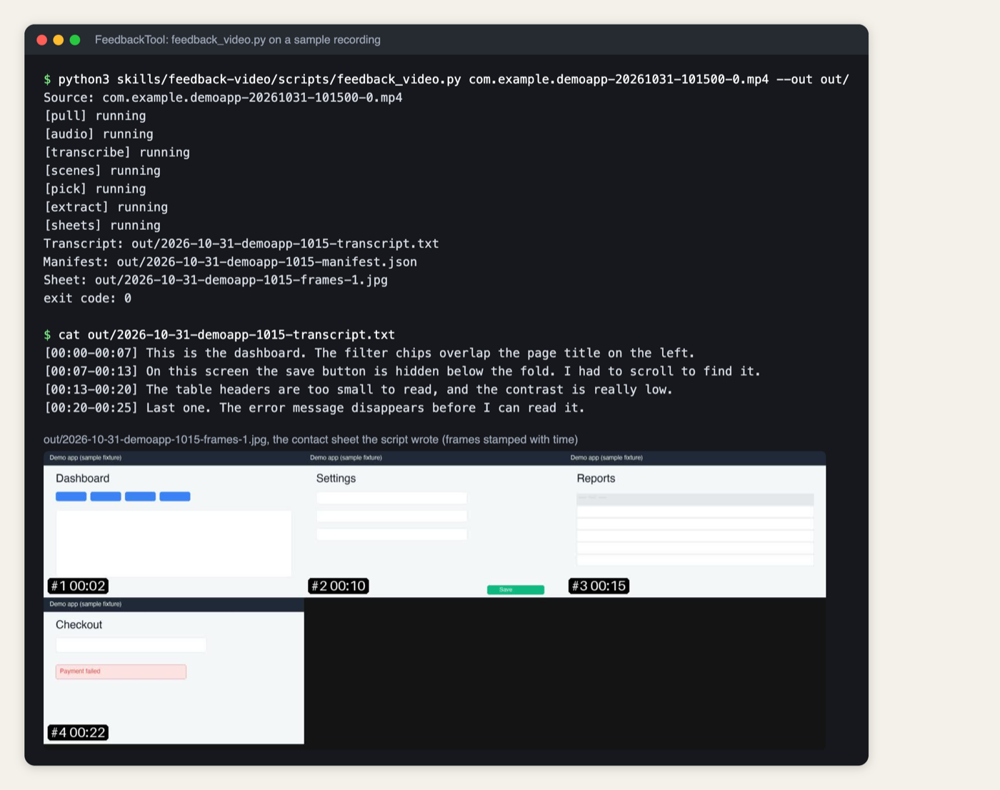

# FeedbackTool

**Problem.** Typing up bug reports after testing an app is slow, and having a frontier model watch the recording instead is expensive.

**Idea.** Talk through what is wrong on a recording. A local script turns it into a timestamped transcript and stamped contact sheets, and one small-model pass writes the issues doc.

**Built.** A Claude Code plugin with one skill, `feedback-video`, and a Python script (ffmpeg, whisper, Pillow) that pulls the newest Meta Quest recording over adb or takes any local video, with unit tests. 4 commits on 2 days, Sep 18 to Oct 20, 2026.

**Decision.** A local script does the transcription and frame picking, and one Sonnet pass writes the issues doc, instead of the session model watching the video. A five-minute recording then costs a few images and one Sonnet pass.



Record yourself talking through what is wrong with your app. Get a list of issues back.

A Claude Code plugin with one skill, `feedback-video`. A local script turns the
recording into a timestamped transcript and a few contact sheets of stamped frames.
One small-model pass reads those and writes the issues doc. The expensive model never
watches video.

## What it does

1. Pulls the newest recording from a Meta Quest over adb, or takes any local video file.
2. Transcribes the audio with whisper, on your machine.
3. Picks frames where you were talking, plus scene changes, capped near 40 for a
   five minute video.
4. Stamps each frame with its time and tiles them 3x3 into sheets.
5. A Sonnet subagent reads the transcript and sheets and writes
   `docs/feedback/<date>-<slug>-issues.md`: a lettered status table, every item tied
   to a timestamp and a quote.

Video, audio and full-size frames stay in a local cache and never enter your repo.

## Requirements

- `ffmpeg`
- `whisper` CLI (`pipx install openai-whisper`)
- Python 3 with Pillow
- `adb`, only for pulling from a headset

## Install

```
/plugin marketplace add weeeha/FeedbackTool
/plugin install feedback-tool@feedback-tool-marketplace
```

## Use without Claude

```
python3 skills/feedback-video/scripts/feedback_video.py path/to/video.mov --out out/
```

## Tests

```
cd skills/feedback-video/scripts && python3 -m unittest
```
